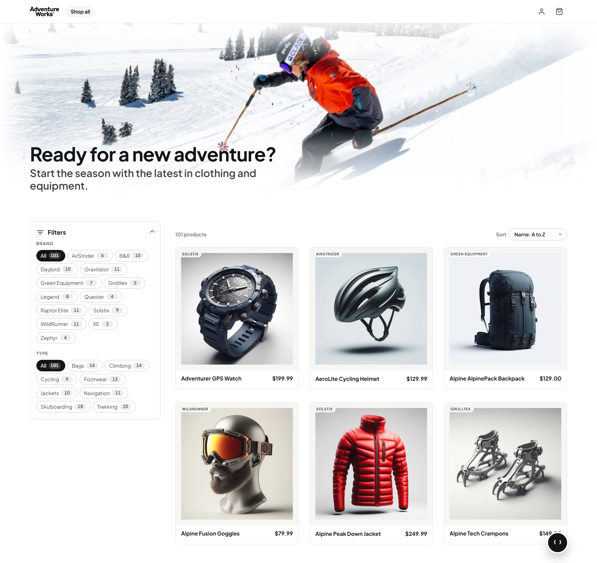

# eShop on Abblix OIDC Server: a worked IdentityServer migration

Microsoft's [eShop](https://github.com/dotnet/eShop) reference application with its OpenID Connect
provider migrated from Duende IdentityServer to
[Abblix OIDC Server](https://github.com/Abblix/Oidc.Server). Everything else is upstream: the same
.NET Aspire orchestration, the same Blazor storefront, the same microservices, the same APIs.

Clone it to see what moving an ASP.NET Core identity provider off IdentityServer actually touches:
client and scope registration, the login and logout screens, claim mapping, signing keys and token
persistence. On the consuming side it touches almost nothing. No resource server was modified and
no authority URL changed; the two client applications gained four statements between them, so that
each names in full the scopes it requests. Every step is explained, with the alternatives that were
rejected and why, in the
[step-by-step migration guide](https://docs.abblix.com/docs/migrate-from-identityserver).

## Why this fork exists

Trying an identity library is normally expensive: you find out what it costs only after you have
wired it into your own system, and by then you have paid for the answer. This fork moves that
expense somewhere else. eShop is public and familiar to most .NET developers, it runs
IdentityServer upstream, and both versions build and run, so the whole comparison is a diff between
two commits of an application you already know rather than a plan you have to imagine.

It is not an argument for leaving Duende IdentityServer. That is a mature product with a decade of
production behind it, and a system running well on it has no reason here. What this fork offers is
the other half of the decision, the one a data sheet cannot give: what the move actually touches,
and where a library that ships fewer batteries hands work back to you.

If you do have your own reason to move, or you are simply looking at what else the ecosystem
offers and would rather try one than read about it, this is the fork to clone and study. It runs
on your machine in a few minutes, and every decision behind it is written up in the guide.

> **Unofficial fork.** Maintained by Abblix LLP. Not affiliated with, endorsed by, or supported by
> Microsoft or the .NET Foundation; their names and logos remain their respective owners'. The
> upstream code stays under its original MIT licence, reproduced unchanged in [LICENSE](LICENSE).
> Abblix OIDC Server is a separate product under its own licence, consumed here as a NuGet package.

## What eShop is

A reference .NET application implementing an e-commerce website using a services-based architecture with [Aspire](https://aspire.dev/).




## Getting Started

This version of eShop is based on .NET 10. Its identity server, Identity.API, runs on .NET 11, the
runtime Abblix OIDC Server 3.0 is built for.

Upstream, including its earlier releases: [dotnet/eShop](https://github.com/dotnet/eShop).

### Prerequisites

1. Install a [.NET 11 SDK](https://dotnet.microsoft.com/download/dotnet/11.0) that satisfies [`global.json`](global.json), and the [.NET Runtime 10 and ASP.NET Core Runtime 10](https://dotnet.microsoft.com/download/dotnet/10.0) the other services run on.
2. Install the [Aspire CLI](https://aspire.dev/get-started/install-cli/) and verify that it is available:

    ```console
    aspire --version
    ```

3. Install and start an OCI-compatible container runtime. [Docker Desktop](https://www.docker.com/products/docker-desktop/) is the recommended default. [Podman](https://podman.io/docs/installation) is also supported; follow the [Aspire prerequisites](https://aspire.dev/get-started/prerequisites/) to configure it.
4. Clone the repository:

    ```console
    git clone https://github.com/Abblix/eShop.git
    cd eShop
    ```

5. Until Abblix OIDC Server 3.0 is published on nuget.org, its packages come from GitHub Packages, which needs a GitHub personal access token with the `read:packages` scope. Set it for the restore:

    ```powershell
    $env:NuGetPackageSourceCredentials_abblix = "Username=<GitHub user>;Password=<token>"
    ```

    ```bash
    export NuGetPackageSourceCredentials_abblix="Username=<GitHub user>;Password=<token>"
    ```

No separate Aspire workload or Visual Studio component is required; the AppHost SDK and hosting integrations are referenced by the projects in this repository.

#### Optional IDE setup

- [Visual Studio](https://visualstudio.microsoft.com/vs/) with the `ASP.NET and web development` workload.
- [Visual Studio Code with C# Dev Kit](https://code.visualstudio.com/docs/csharp/get-started) and the [Aspire extension](https://aspire.dev/get-started/aspire-vscode-extension/).
- The [.NET MAUI workload](https://learn.microsoft.com/dotnet/maui/get-started/installation) if you want to run the client apps.

### Running the solution

> [!WARNING]
> Ensure that your container runtime is running before starting eShop.

#### From the terminal

From the repository root, run:

```console
aspire run
```

The root [`aspire.config.json`](aspire.config.json) selects `src/eShop.AppHost/eShop.AppHost.csproj`, avoiding ambiguity with the test AppHosts in the repository. When startup completes, the CLI prints a dashboard URL similar to:

```text
Dashboard: https://localhost:<port>/login?t=<token>
```

Press <kbd>Ctrl</kbd>+<kbd>C</kbd> to stop the AppHost. See the [`aspire run` command](https://aspire.dev/reference/cli/commands/aspire-run/) for additional options.

To run the AppHost in the background instead:

```console
aspire start
aspire ps
```

When you are finished, run `aspire stop`. See the [`aspire start` command](https://aspire.dev/reference/cli/commands/aspire-start/) for details.

#### From Visual Studio

1. Open `eShop.Web.slnf`.
2. Set `src/eShop.AppHost/eShop.AppHost.csproj` as the startup project.
3. Press <kbd>Ctrl</kbd>+<kbd>F5</kbd> to start eShop and open the Aspire dashboard.

Sign in to the storefront as `alice` or `bob`, password `Pass123$`. Both are created on first run by
[UsersSeed.cs](src/Identity.API/UsersSeed.cs). The login screen you land on is the application's own
page, [Login.cshtml](src/Identity.API/Views/Account/Login.cshtml): Abblix OIDC Server answers the
protocol endpoints and knows only where to send an unauthenticated user, which is the boundary this
fork was built to show. What it issues afterwards is the token behind the claims the checkout form
fills itself from.

Every token names its issuer, and the services accept a token only when that issuer is exactly the
address they were given for the identity server. Abblix OIDC Server 3.0 takes the issuer from
configuration rather than from each request, so the AppHost hands `identity-api` the same
address as its `Oidc__Issuer` that it hands every other service as the identity server's. Running
`identity-api` without the AppHost means setting `Oidc__Issuer` yourself. The server writes the configured issuer into
discovery and every token whatever host name a request arrives with, and the MAUI app's OpenID
client refuses a discovery document whose issuer differs from the address it asked. In the
Android emulator the app reaches your machine as `10.0.2.2` rather than `localhost`, so it
cannot sign in.

### Running tests

Run the server tests:

```powershell
dotnet test --solution eShop.Web.slnf
```

Run the Playwright browser journeys. Playwright starts the AppHost automatically, so ensure your container runtime is running first.

```powershell
npm ci
npx playwright install chromium
npm run test:e2e
```

### Optional: AI Chatbot with Microsoft Foundry

This option provisions a Microsoft Foundry resource during local development, so first authenticate to Azure and configure the subscription and location:

```powershell
az login
aspire secret set "Azure:SubscriptionId" "<subscription-id>"
aspire secret set "Azure:Location" "eastus"
```

Then enable Foundry and start eShop:

```powershell
$env:UseFoundry = "true"
aspire run
```

Aspire provisions the `gpt-4.1-mini` and `text-embedding-3-small` deployments and injects their connection information into the consuming projects. The Foundry hosting integration currently uses a preview package. See [local Azure provisioning](https://aspire.dev/integrations/cloud/azure/local-provisioning/) and the [Microsoft Foundry hosting integration](https://aspire.dev/integrations/cloud/azure/azure-ai-foundry/azure-ai-foundry-host/) for details.

### Deploy to Azure Container Apps

The AppHost is already configured with an Azure Container Apps environment, so the Aspire CLI can deploy directly from the application model. See the [Aspire Azure Container Apps deployment guide](https://aspire.dev/deployment/azure/container-apps/) for details.

> [!WARNING]
> This sample deploys PostgreSQL, Redis, and RabbitMQ as containers in Azure Container Apps. This configuration is intended for evaluation and demonstrations, not production data.

Prerequisites:

- The prerequisites listed above, including a running container runtime.
- The [Azure CLI](https://learn.microsoft.com/cli/azure/install-azure-cli), an active Azure subscription, and permission to create resources.

Sign in, optionally preview the deployment pipeline, and deploy:

```console
az login
aspire deploy --list-steps
aspire deploy
```

For local interactive use, `aspire deploy` prompts for missing Azure settings. For non-interactive use, provide them explicitly:

```powershell
$env:Azure__SubscriptionId = "<subscription-id>"
$env:Azure__Location = "eastus"
$env:Azure__ResourceGroup = "rg-eshop-demo"
aspire deploy --non-interactive
```

Use [`aspire publish`](https://aspire.dev/reference/cli/commands/aspire-publish/) when you need deployment artifacts for inspection or another deployment tool. Running it first is not required: `aspire deploy` invokes the deployment pipeline and its dependencies directly rather than consuming an earlier publish output.

When you no longer need the deployment, run [`aspire destroy`](https://aspire.dev/reference/cli/commands/aspire-destroy/). This deletes the entire configured resource group, including resources that Aspire did not create, so review the target carefully before confirming.

## Contributing

This is a demonstration fork, and the two halves have different homes. Anything about eShop itself
belongs upstream at [dotnet/eShop](https://github.com/dotnet/eShop): changes made here would not
reach the people maintaining it. Anything about the migration or the Abblix provider under it is
welcome as an issue in this repository.

### Sample data

The sample catalog data is defined in [catalog.json](https://github.com/dotnet/eShop/blob/main/src/Catalog.API/Setup/catalog.json). Those product names, descriptions, and brand names are fictional and were generated using [GPT-35-Turbo](https://learn.microsoft.com/en-us/azure/ai-services/openai/how-to/chatgpt), and the corresponding [product images](https://github.com/dotnet/eShop/tree/main/src/Catalog.API/Pics) were generated using [DALL·E 3](https://openai.com/dall-e-3).

## eShop on Azure

For a version of this app configured for deployment on Azure, please view [the eShop on Azure](https://github.com/Azure-Samples/eShopOnAzure) repo.
